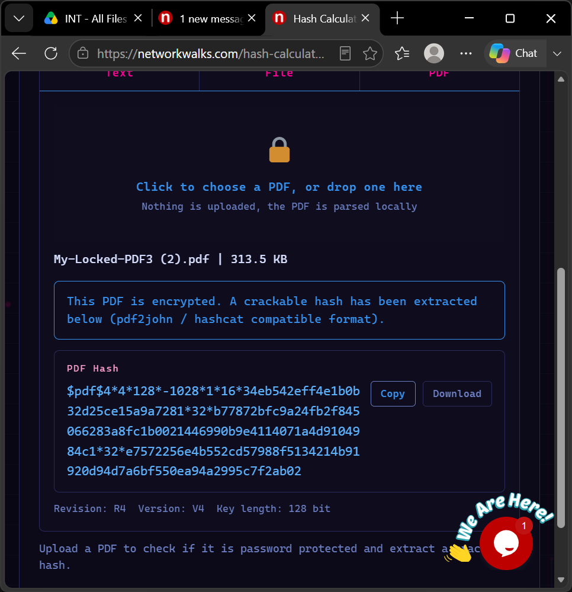
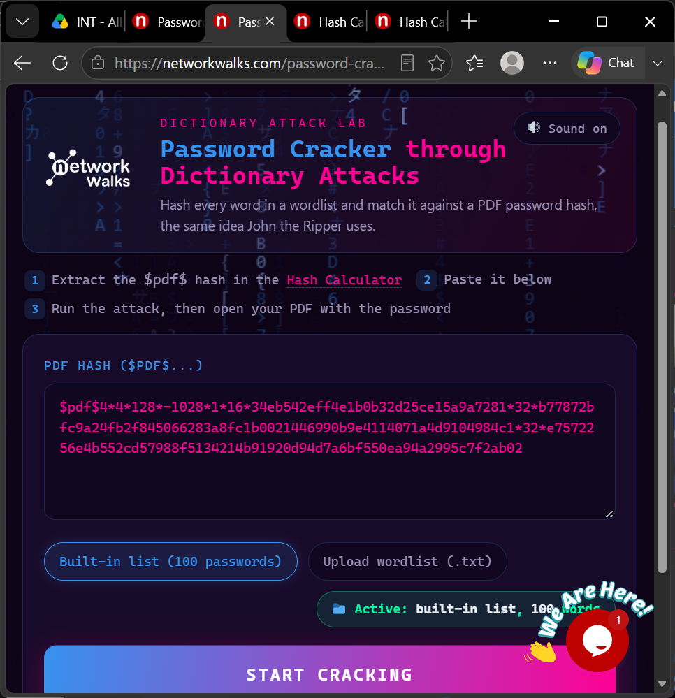
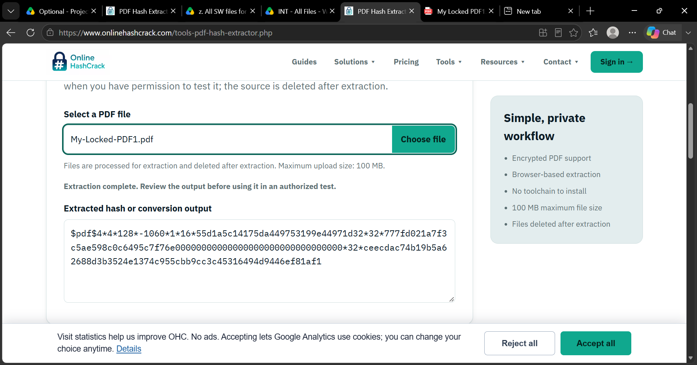
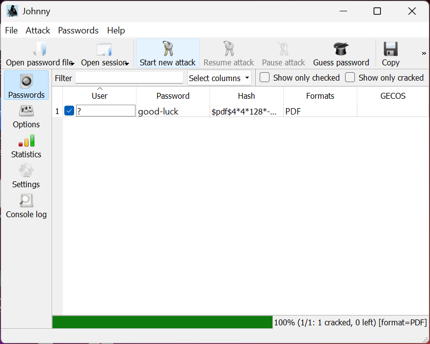
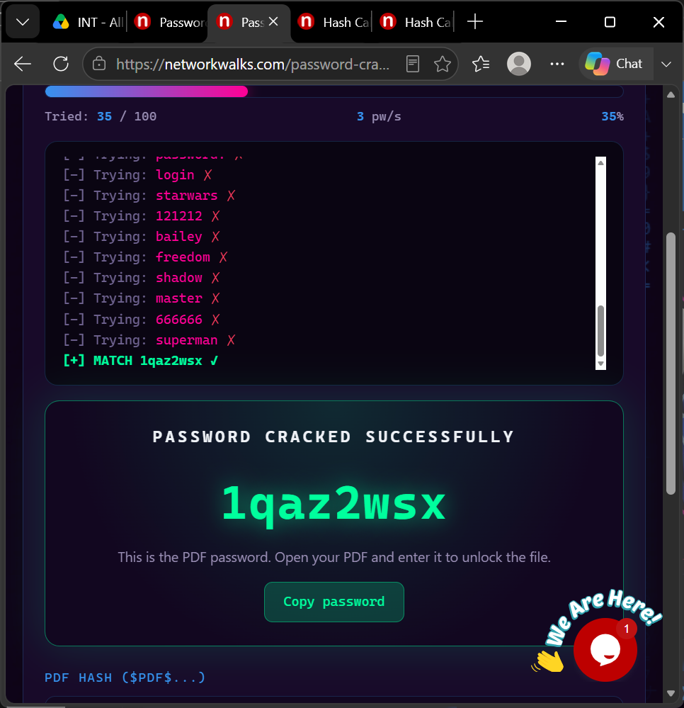
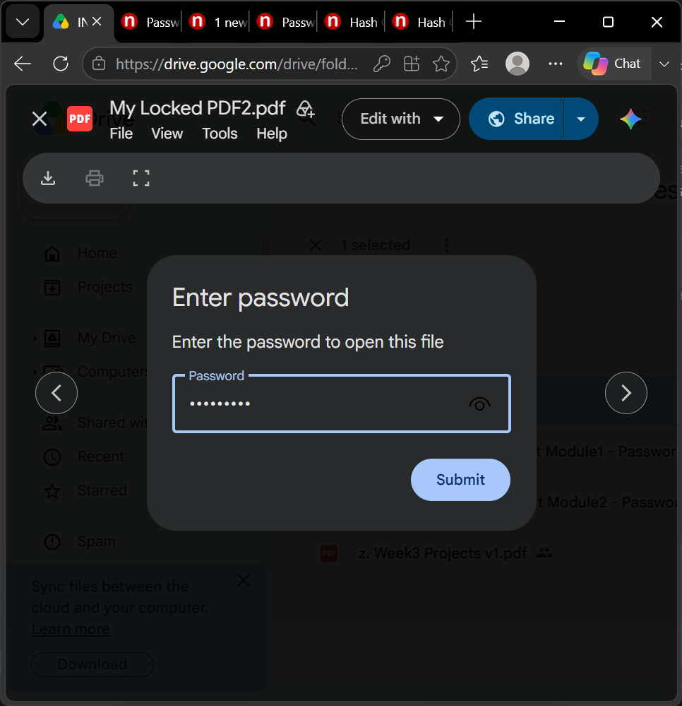

# 🔐 PDF Password Recovery & Flag Capture

## Project Overview

This project documents a practical PDF password recovery exercise completed as part of my cybersecurity learning journey.

The objective was to explore two approaches to extracting PDF password hashes and recovering passwords through dictionary-based attacks, followed by capturing the challenge flag.

## Objectives

- Understand how password-protected PDF files work.
- Extract PDF password hashes using different tools.
- Perform dictionary-based password recovery.
- Practise using password recovery tools.
- Successfully capture the challenge flag.

## Tools and Methods Used

### Method 1: Networkwalks Free Tools
- Hash Calculator
- Password Cracker (Dictionary Attack)

### Method 2: Separate PDF Hash Extractor and John the Ripper
- PDF Hash Extractor Website
- John the Ripper

## Methodology

### Method 1: Networkwalks Free Tools

**Step 1: Hash Calculator**

I used the Networkwalks Hash Calculator to process the password-protected PDF and obtain the hash required for password recovery.

**Step 2: Password Cracker – Dictionary Attack**

I used the Networkwalks Password Cracker to test password candidates from a dictionary against the extracted hash.

### Method 2: PDF Hash Extractor and John the Ripper

**Step 1: PDF Hash Extraction**

I used a separate PDF Hash Extractor website to extract the password hash from the protected PDF.

**Step 2: Password Recovery with John the Ripper**

I used John the Ripper to perform a dictionary-based password recovery process by testing candidate passwords from a wordlist against the extracted hash.

## Screenshots and Evidence

The following screenshots document the tools, recovery process, and challenge completion.

### Method 1: Networkwalks Free Tools

**1. Networkwalks Hash Calculator**

**2. Networkwalks Password Cracker**

### Method 2: PDF Hash Extractor and John the Ripper

**3. PDF Hash Extraction**

**4. John the Ripper**

**5. Password Recovery Result**

**6. PDF Opened After Recovery**

### Challenge Completion

**7. Flag Captured – Evidence 1**

**8. Flag Captured – Evidence 2**

**9. Flag Captured – Evidence 3**

## Skills Learned

- PDF password hash extraction
- Dictionary-based password attacks
- Password recovery techniques
- Using Networkwalks cybersecurity tools
- Practical use of John the Ripper
- Understanding password security
- Cybersecurity lab documentation

## Conclusion

This exercise gave me practical experience with two different PDF password recovery approaches. I learned how password hashes can be extracted and how dictionary attacks can be used to test password candidates.

Completing the challenge and capturing the flag strengthened my understanding of password security and hands-on cybersecurity techniques.

## Disclaimer

This project was completed for educational and cybersecurity training purposes in an authorized lab environment. These techniques should only be used on files you own or have explicit permission to test.
